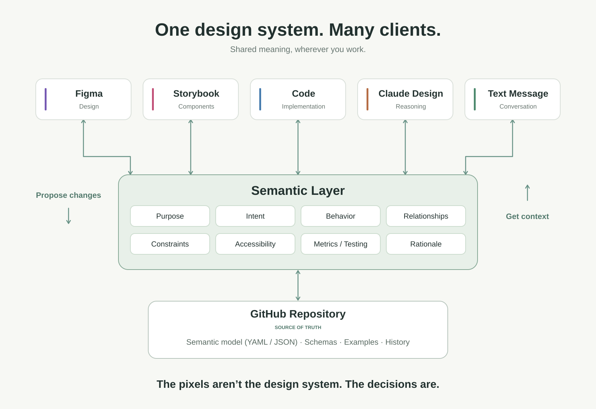

# Semantic Design System

**One design system. Many clients.**

The design system lives outside any single design tool as a shared semantic layer. Figma, Storybook, Code, Claude Design, and Text Message are clients that can propose changes and retrieve context.

The semantic layer captures Purpose, Intent, Behavior, Relationships, Constraints, Accessibility, Metrics / Testing, and Rationale.

GitHub is the source of truth for the semantic model (YAML / JSON), schemas, examples, and history. This initial repository documents the architecture; the model and client integrations are yet to be implemented.

## Workflow

[Editable SVG](workflow.svg) · [PlantUML source](workflow.puml)

The pixels aren’t the design system. The decisions are.
